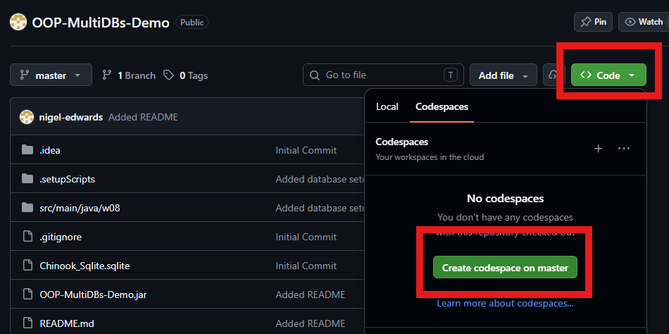
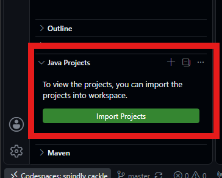
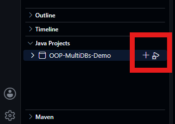

# Simple JDBC Demonstration

This project is intended for use in conjunction with the week 08 material for MOD004881 Object Oriented Programming. It demonstrates using JDBC to connect to different vendor relational databases with the same schemas by just altering the connection string. The example database schema is the freely available [Chinook Database](https://github.com/lerocha/chinook-database/tree/master/ChinookDatabase/DataSources). The project is designed to be used with GitHub CodePages and includes setup scripts to install two docker images for MySQL and PostgreSQL servers together with a simple SQLite database file.

**To Use**

1. Create a new CodeSpace from the GitHub repository.

    

3. Install the Java extension.

    

5. Import the Java Project.

    

7. In a terminal run the databases setup script.  This may take a bit of time and there are some sleeps to ensure the services start before the databases are added.

    ```bash
    bash .setupScripts/setupdatabases.sh
    ```

8. Run the Java Project ```DBExample```.

    
    
